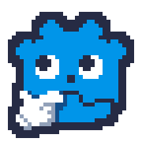

<h1>rvrsdev</h1>

Fellow Godot Engine and Linux enjoyer. Also interested in music and web development.   Currently working on <a target="_blank" href="https://riked.pl">riked.pl</a>

<h2>Projects</h2>

  <a target="_blank" href="https://play.google.com/store/apps/details?id=com.riverstudio.fluidbalance">Fluid Balance</a> - minimalistic water sort game but with one major twist: liquid weight. Available on Google Play.
  Made with Godot Engine 4.   
  <a href="https://github.com/overlord-repo">
  

  <a target="_blank" href="https://play.google.com/store/apps/details?id=com.riverstudio.bodegacat">Bodega Cat</a> - immersive shop management simulator set up NYC with a friendly cat companion. Available on Google Play.
   Made with Godot Engine 4.   
  <a href="https://github.com/ShadowAngel27">
  

 <a target="_blank" href="https://riked.pl">riked.pl</a> - website for a polish window repair service with an AI chatbot feature. Website build with Next JS, deployed with Cloudflare workers. AI bot written in python using LangGraph framework, deployed with Railway.

  

